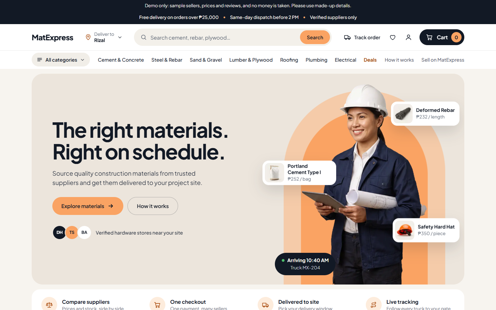
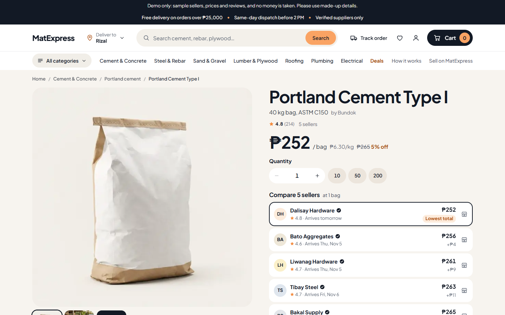
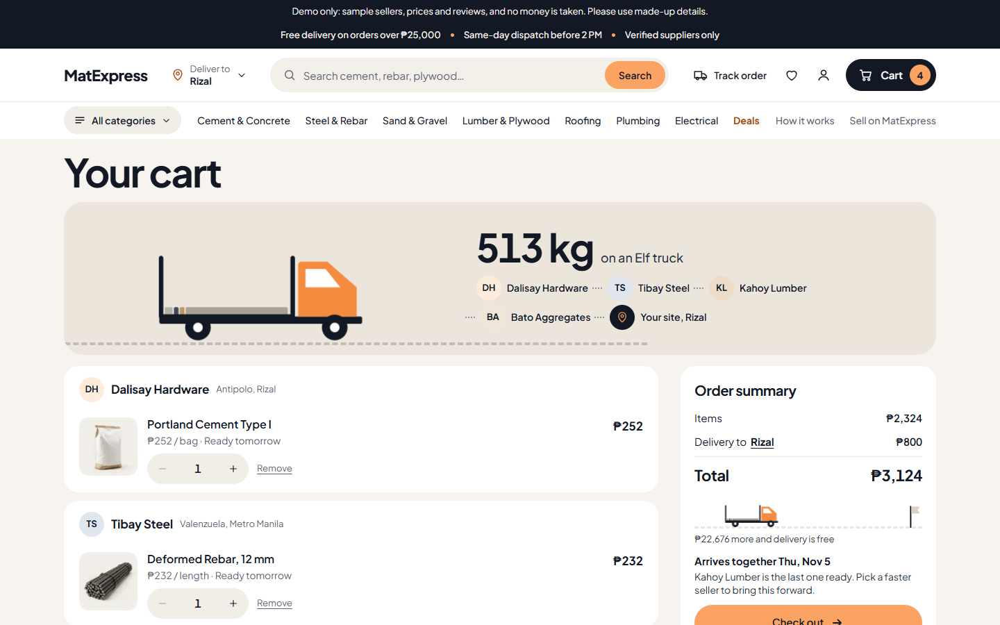
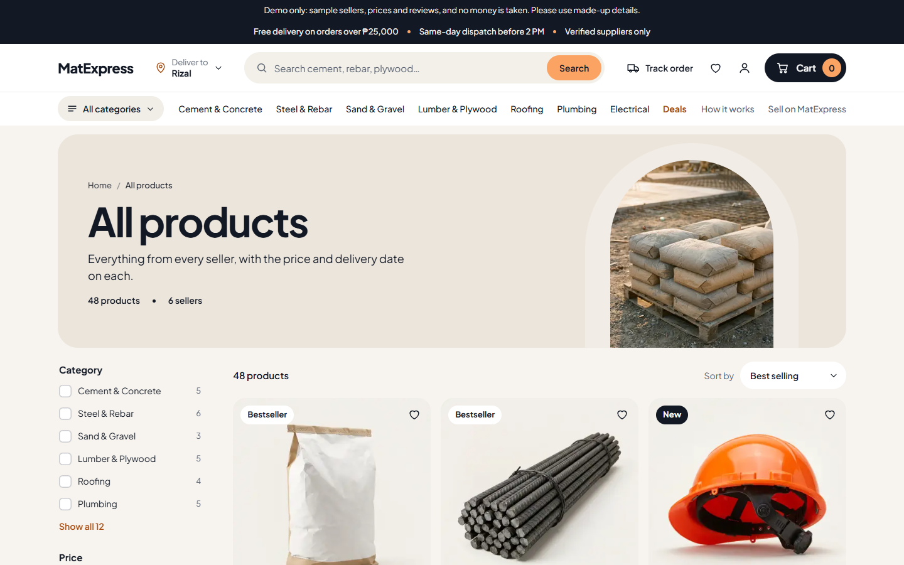
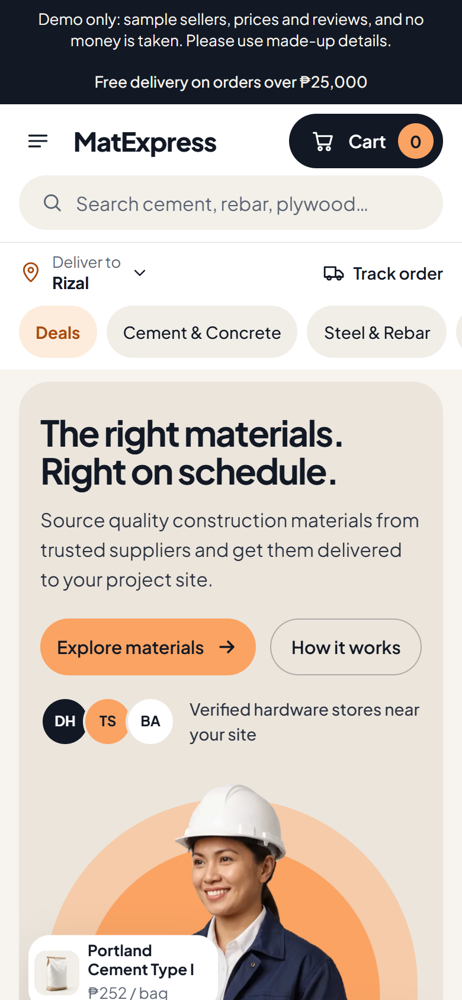

# MatExpress

**A marketplace where contractors and architects order construction materials from many hardware stores, check out once, and have everything delivered to site together.**

**[Try the live demo →](https://matexpress.vercel.app)** (sample sellers, prices and reviews; no money is taken)




## What it does

- **Compare sellers on every product.** Each product lists every store that stocks it, with its price, rating and delivery date, and points out the lowest total.
- **One cart, one checkout, many stores.** The cart groups items by seller, shows how the whole load fits on a truck, and gives one delivery date for everything.
- **Track any order** with its order number and mobile number. No account needed.
- **Accounts** with saved delivery sites, saved items, password changes and account deletion.
- **For sellers:** store pages, a "sell on MatExpress" section and an application form.
- **Help pages** for delivery, returns and contact, plus deals and search.
- Works on phones, tablets and desktops.

| Compare sellers | Multi-store cart | Catalog | On a phone |
|:-:|:-:|:-:|:-:|
|  |  |  |  |

## How it's built

| Part | Built with |
|---|---|
| App | Next.js 16 (App Router, Server Actions), React 19, TypeScript |
| Styling and motion | Tailwind CSS 4, GSAP, Lenis, Three.js with a no-WebGL fallback |
| State | Zustand for the cart and shopper preferences |
| Data | PostgreSQL on Neon (Singapore), Drizzle ORM and migrations |
| Accounts | Better Auth |
| Testing | Vitest, Testing Library, Playwright, axe |
| Hosting | Vercel (Singapore region), GitHub Actions on every push |

## Security

- **The server decides the price.** Prices, totals, stock and delivery dates are always worked out on the server. Prices sent by the browser are only compared, never trusted.
- **No double charges.** An order is saved before any charge, and one key means one order, so a retried checkout can't charge twice.
- **Rate limits** on sign-in, sign-up, password changes, order lookups, placing orders and seller applications, counted in the database so every server instance shares them.
- **Accounts:** salted scrypt password hashes, screening for common passwords, and the same message for a wrong email or a wrong password.
- **Browser protections:** a content security policy, HSTS and other security headers.

The full list, including what isn't built yet, is in [SECURITY.md](SECURITY.md).

## Testing

- **40 unit and component test files** (Vitest, Testing Library). They need no database.
- **Browser tests** (Playwright) for browsing, a real order, accounts, accessibility with axe, a failing database and a browser without WebGL.
- **Database tests** for the order code, including buyers racing for the last unit of stock.
- **GitHub Actions** runs lint, type checks, tests and a dependency audit on every push.

## Run it locally

1. Copy `.env.example` to `.env.local` and fill it in. You'll need a [Neon](https://neon.tech) database in Singapore.
2. Install, set up the database, and start:

```bash
npm install
```

```bash
npm run db:migrate
```

```bash
npm run db:seed
```

```bash
npm run dev
```

The store is at [http://localhost:3000](http://localhost:3000).

### Commands

| Command | What it does |
| --- | --- |
| `npm run dev` | Runs the store while you work on it |
| `npm run build`, `npm start` | Builds it for production, and runs that build |
| `npm test` | Unit and component tests. Needs no database |
| `npm run test:e2e` | Browser tests, after a build: every page, a real order, accounts, accessibility, and the database failing |
| `npm run test:db` | The order code against a real database, with buyers racing for the last of the stock |
| `npm run lint` | Lint |
| `npm run check:links` | Finds broken links on a running server |
| `npm run check:deploy <url>` | Checks a deployed copy from the outside |
| `npm run db:generate`, `npm run db:migrate` | Writes a migration from `src/db/schema.ts`, and applies it |
| `npm run db:seed` | Fills an empty catalog with the sample data |

## Where things are written down

- [docs/deploying.md](docs/deploying.md): putting the demo online, checking it, and what to do when something goes wrong
- [docs/rendering-and-data.md](docs/rendering-and-data.md): how pages are served and use the database, and the rules for new code
- [SECURITY.md](SECURITY.md): what protects buyers, what isn't built yet, and the go-live checklist
- [docs/superpowers/plans/2026-11-01-store-pages.md](docs/superpowers/plans/2026-11-01-store-pages.md): what was built and why, and what's still sample data
- [AGENTS.md](AGENTS.md): this version of Next.js differs from older ones. Its guides are in `node_modules/next/dist/docs/`

---

Built by [Zaimond Lim](https://github.com/limmonjuice).
